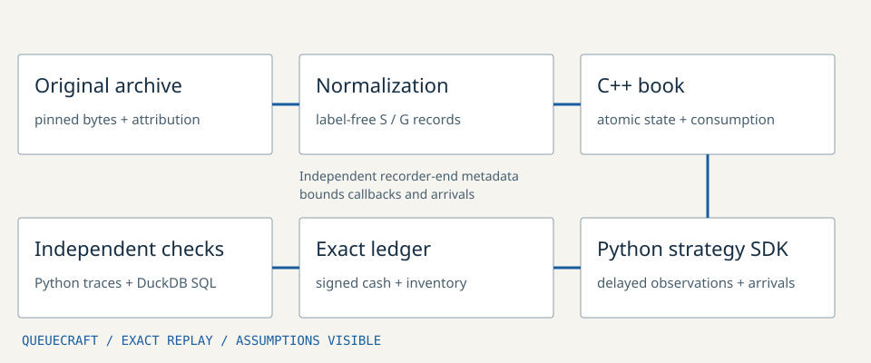

# QueueCraft

**An embeddable C++20 execution-research engine that makes uncertain assumptions visible.**

Exact tick/lot accounting, deterministic books, a typed Python strategy SDK,
independent book/ledger checks and registered policy comparisons. Research
software, prepared version 0.1.0. No brokerage route or live orders.



## Compute and inspect an order

Requires Python 3.11+ and Clang/GCC with C++20 on macOS/Linux. The study extra
installs pinned DuckDB 1.4.3 for independent SQL reconciliation.

```sh
python3 -m venv .venv
. .venv/bin/activate
python -m pip install '.[study]'
queuecraft validate examples/recorded.csv
queuecraft simulate examples/recorded.csv --size 25 --policy twap \
  --recording-metadata examples/recorded-provenance.json --out first-order
queuecraft verify first-order
```

Open `first-order/report.html`. Change to `--size 50` and a fresh output folder
to compute a new trace. The [saved example](examples/demo/report.html) includes
input, configuration, every decision/order/fill, recorded books and SQL checks.
GitHub displays HTML source; open a local download to interact.

Recording coverage is explicit metadata, independent of the final book message.
A quiet recording can end after its last quote. `--recording-end-ns` or
`--recording-duration-seconds` can provide a known acquisition bound instead.
Do not invent a recording end to extend data availability. Sparse or stale
quotes still obey the declared watchdog and staleness rules.

On Apple Silicon with a universal Python installation, use
`ARCHFLAGS="-arch arm64"` for the install if a second architecture is unavailable.
No trading credentials, model weights or billed service are used.

## Add an installed strategy

```python
from queuecraft import Observation, OrderRequest

class OneLotAtATime:
    def decide(self, observation: Observation) -> OrderRequest:
        return OrderRequest(min(1, observation.remaining))
```

Callbacks receive immutable delayed market prefixes, acknowledged fills and
remaining reservations. Recorder bounds are declared inputs; future payloads
cannot change earlier callbacks, fills or acknowledgements when those bounds
are held fixed. Evaluation-only benchmark prices are not placed in the strategy
observation. Strategies are trusted Python, not a security sandbox.

The separate [consumer](examples/strategy.py) uses only installed public APIs.
It declares the bundled example’s known 31-second extraction bound; for another
recording, replace that declaration with its independently known coverage:

```sh
# From outside the source checkout, after installation:
python /path/to/strategy.py /path/to/recorded.csv 25
```

The C++ [public header](include/queuecraft/engine.hpp) exposes strict parsing,
`Engine::apply` and `Engine::take`. Install a static SDK and compile the separate
[C++ consumer](tests/cpp/consumer.cpp) against installed files only:

```sh
make all
make install PREFIX=/tmp/queuecraft-sdk
c++ -std=c++20 -pthread -I/tmp/queuecraft-sdk/include \
  tests/cpp/consumer.cpp /tmp/queuecraft-sdk/lib/libqueuecraft.a -o /tmp/consumer
/tmp/consumer
```

## Models and evidence

| Part | Implemented contract |
| --- | --- |
| State | Single writer; atomic full snapshots or absolute updates; zero deletes; invalid after a gap until a new snapshot; bounded input |
| Arithmetic | Checked 64-bit ticks/lots, integer tick×lot money, per-fill fee ceiling and rollback on overflow |
| Timing | Exchange, capture, policy observation, hypothetical arrival and acknowledgement remain separate; declared ties and no-op deadline fallback |
| Execution | Marketable IOC sweeps, partial fills, exact signed cash/inventory and consumed liquidity across surviving recorded levels |
| Policies | Immediate, TWAP, a spread-aware baseline, the retained prior horizon heuristic and a joint latency/liquidity horizon policy |
| Verification | Complete independent Python/native traces, substantive DuckDB joins/windows, causal mutations, installed consumers and systems measurements |

TWAP splits an order over time. Receding-horizon planning recomputes a remaining
order plan after each observation. The new planner scores the same future plan
across a fixed latency/liquidity/drift family; it cannot select different future
actions with knowledge of the hidden environment. [Planning method](docs/PLANNING.md).
It remains a finite heuristic, not a calibrated guarantee or proof of advantage.

The small-order regime is declared: the bundled study caps parents at 100 shares
and 1% of initial opposing top-ten depth on either side. Generic imported units
and caps are the caller's responsibility. Historical markets do not react to
hypothetical trades. There are no passive orders, observed queue positions or
maker rebates; taker fees are explicit nonnegative research assumptions.

## Registered prospective study

The new protocol uses licensed 15-minute binary-contract windows across eight
assets and four capture dates. Entire opening UTC days are reserved before
eligibility: August 21–23 development, August 24 confirmation. A prefix-only
quote/depth rule defines operational stress proxies. These are not independently
established financial-crisis labels. Both proxy groups are represented in the
prepared confirmation set.

```sh
python -m tools.prepare_prospective --source data/15m-archive/updown_15m.parquet \
  --known-ids data/15m-archive/prior_known_ids.json --plan docs/PROSPECTIVE_PLAN.json \
  --output /tmp/queuecraft-sessions
queuecraft study /tmp/queuecraft-sessions --plan docs/PROSPECTIVE_PLAN.json \
  --raw-archive data/15m-archive/updown_15m.parquet \
  --calibration docs/COMPUTE_CALIBRATION.json --out /tmp/queuecraft-study
```

The completed run accounts for **84,800 attempts: 66,720 executions and 18,080
retained exclusions**. Independent review recomputed all 209 SQL batches and
480 paired comparison cells. Confirmation has 30 stable and 210 unresolved
stratified cells, with no supported reversal. The horizon policy's lower
penalized cost comes with poor completion: measured mode fills 19,862 of 66,000
requested lots. This does not establish execution superiority.
[Results and interpretation](docs/STUDY.md) · [Aggregate results](docs/study-summary.json).

Saved calibration reproduces the registered compute durations without new
measurements. Omitting `--calibration` runs a separate desktop timing sensitivity.

The protocol retains all window attempts and exclusions, both sides, sizes and
deadlines, execution assumptions and measured policy-computation sensitivity.
[Protocol](docs/PROSPECTIVE_PLAN.json) · [Data contract](docs/DATA.md).
Window uncertainty is conditional on correlated observations. A single
confirmation day does not establish broad independent-day evidence.

The [first five-minute experiment](docs/history/FIVE_MINUTE_STUDY.md) remains a
prior attempt. Its ordinary class was empty, and a subsequent completion audit
found future-endpoint dependence and incomplete latency planning. Its source,
registrations and negative results are preserved. Current commands reject its
old registration instead of silently rerunning a different policy under its
name. It is not the final prospective study.

## Develop and verify

```sh
python -m pip install -e '.[study]'
make test
make sanitize
make tsan
python -m unittest discover -s tests -v
python -m tools.differential examples/recorded.csv --out /tmp/differential.json
```

The native book/accounting hot path preserves the independently checked
baseline; native order execution now also requires recording bounds. Scheduler tests also append later events while keeping recording
metadata fixed, checking every earlier callback/fill/ack. DuckDB independently
validates every ledger transition, run isolation, exact money units, recorder
bounds, missing values and references. Unsupported sanitizer/fuzzer capabilities
are disclosed separately from passing checks.

`RawCapture` journals original bytes supplied by an embedding read-only collector.
Truncation or CRC failure requires a fresh snapshot/session. The bundled archives
are recorded snapshots, not exchange-sequenced wire messages. Actual exchange
time, intersnapshot order and individual liquidity identity remain unidentified.
Restoring an exported order means deterministic replay of its full configuration;
there is no durable partial native checkpoint or crash-atomic exchange service.

[Architecture](docs/ARCHITECTURE.md) · [Exact contract](docs/CONTRACT.md) ·
[Validation](docs/VALIDATION.md) · [Performance](docs/PERFORMANCE.md) ·
[Differences from existing projects](docs/DISTINCTION.md) · [Attribution](NOTICE.md) ·
[Owner walkthrough](docs/WALKTHROUGH.md).
